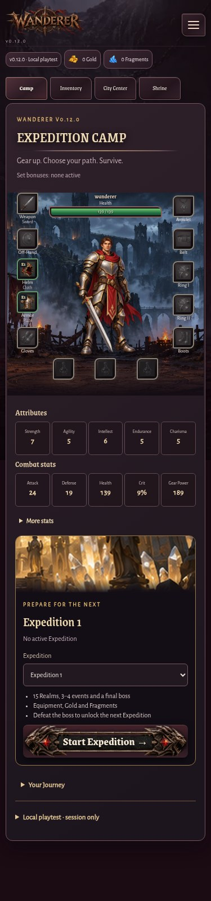
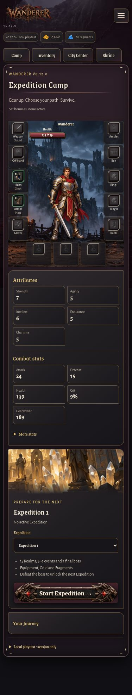
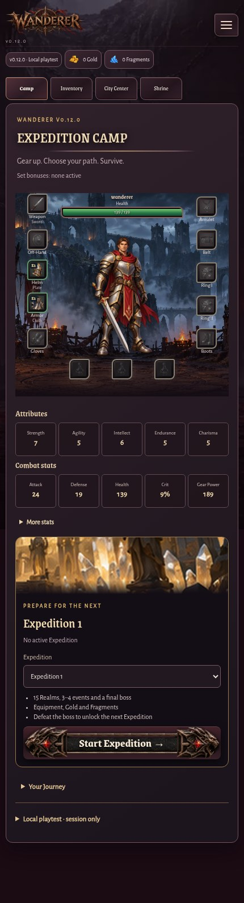
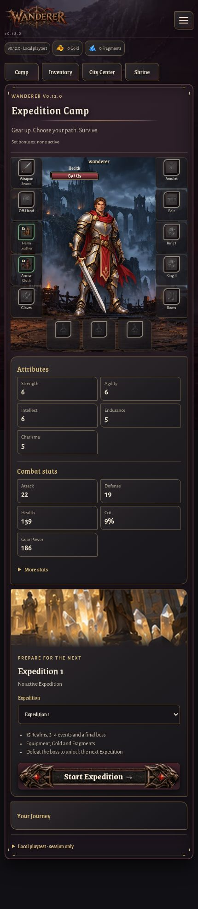
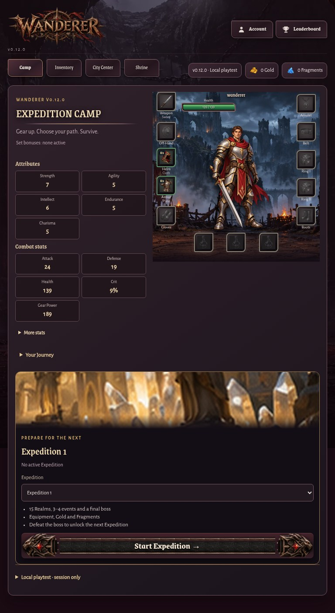
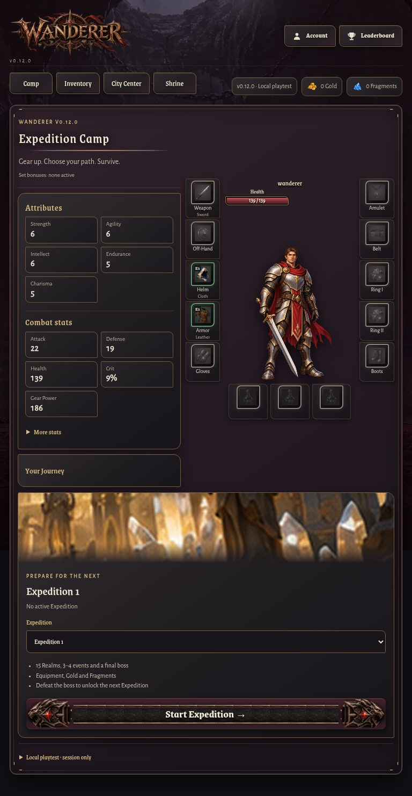
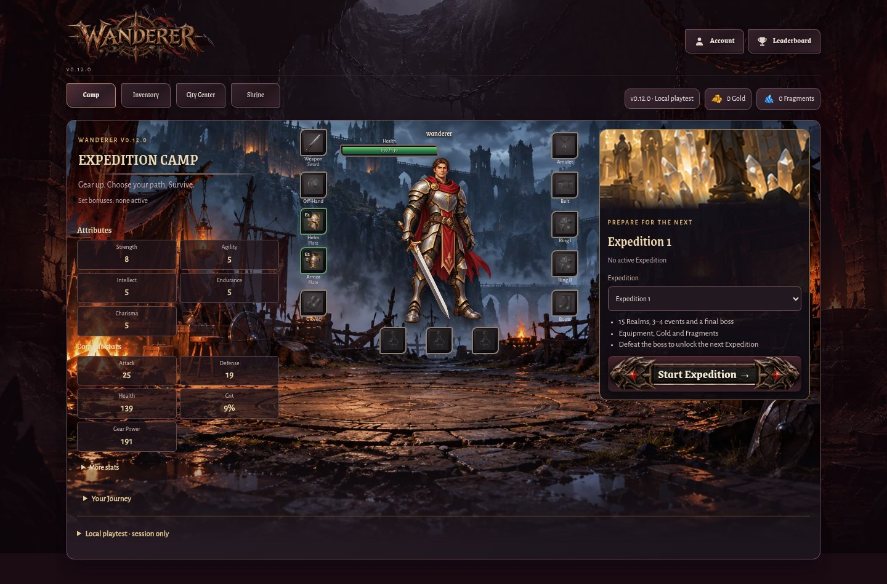
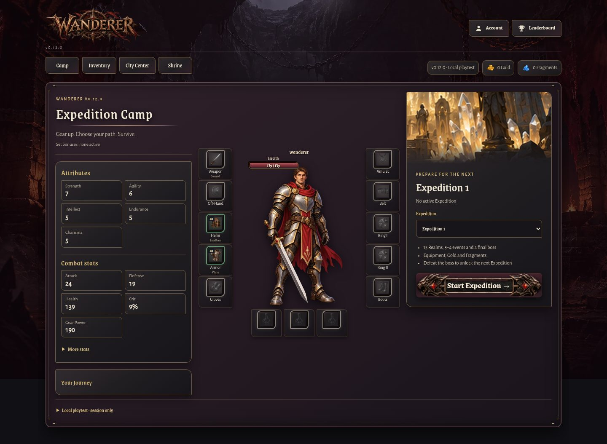
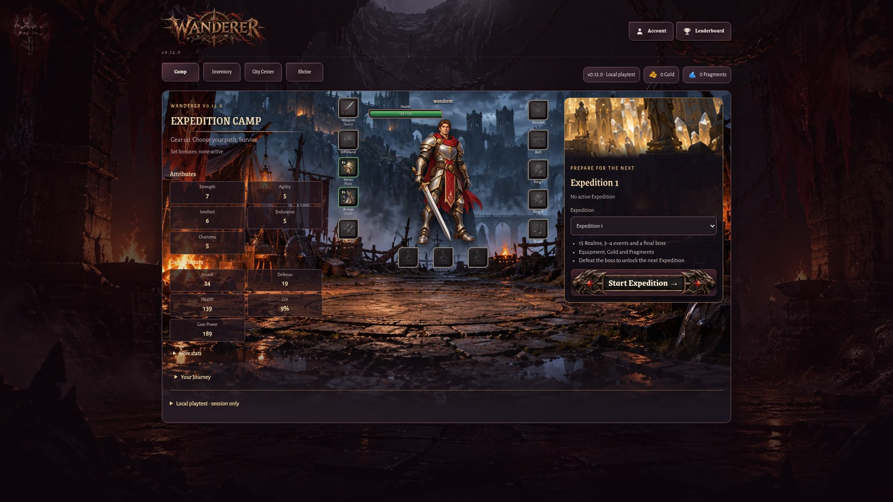
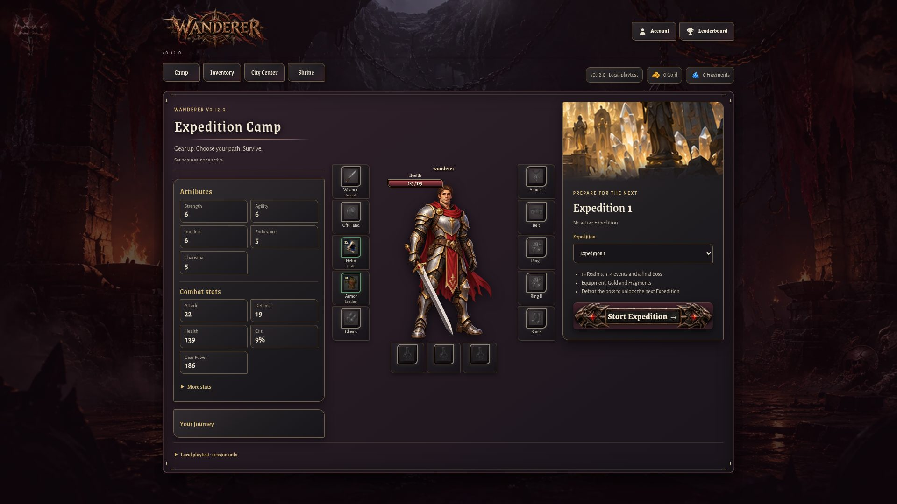

# Gothic Gold UI — Camp Prototype

## Escopo

Protótipo visual aplicado exclusivamente ao Expedition Camp. Mantém o renderer e os controlos nativos de equipamento, poções, stats, navegação e Expedition; não altera gameplay, economia, progressão ou saves.

## Design system e componentes reutilizados

Os tokens Obsidian, Dark Iron, Antique Gold, Highlight Gold, Blood Red e ivory/parchment são ativados apenas enquanto o Camp está montado. A folha existente `v012-ui5-camp.css` implementa os equivalentes reutilizáveis de GothicPanel (stats/journey/Expedition), GothicFrame (moldura do Camp e slots), GothicTabs, GothicProgressBar, GothicItemSlot, GothicStat e GothicDivider. Os slots e imagens continuam a ser renderizados pelos componentes existentes; não foram adicionadas molduras raster nem dependências.

As regras antigas específicas do Camp foram removidas de `v012-phase1.css`, `ux39.css` e `v012-ui4f.css`; regras compartilhadas com preparação, Inventory, Expedition Bag e outras vistas permanecem. As molduras decorativas são CSS, sem esticar assets. O botão Start Expedition existente e as suas pontas decorativas foram preservados.

## Capturas Chromium

Capturas antes correspondem ao estado de `development` antes desta alteração. Capturas depois foram geradas pelo harness Playwright isolado, com dados locais sintéticos.

| Viewport | Antes | Depois |
|---|---|---|
| 375 × 812 |  |  |
| 430 × 932 |  |  |
| 768 × 1024 |  |  |
| 1440 × 900 |  |  |
| 1920 × 1080 |  |  |

## Validação

- `tests/ui-gothic-gold-camp-browser.cjs`: cinco viewports; geometria, ordem responsiva, dez slots de equipamento, três slots de poções, tamanho mínimo de toque, molduras quadradas, tokens, CTA, navegação e erros JavaScript.
- `tests/v012-ui1-browser.cjs`: seis viewports; regressão de Camp/Inventory, comparação e seleção/remoção de poções. O fixture usa a interação atual de confirmar equipamento no modal.
- `tests/v012-unified-gear-potions.test.cjs`: quatro testes unitários, incluindo a composição atual da grelha sem depender de `!important` ou medidas antigas.
- `npm test`: PASS, 290/290 testes.
- `tests/ui-gothic-gold-camp-browser.cjs`: PASS nos cinco viewports indicados.
- `tests/v012-ui1-browser.cjs`: PASS nos seis viewports indicados.
- `tests/v012-unified-gear-potions.test.cjs`: PASS, 4/4.
- `git diff --check` e `node --check` nos testes browser: PASS.

Validação feita em Chromium. Safari/WebKit não foi executado nesta tarefa.

## Limites

O tema global só muda enquanto a vista Camp está presente; outras áreas mantêm a apresentação atual. A auditoria e o protótipo não constituem aprovação para aplicar este sistema às restantes vistas.
