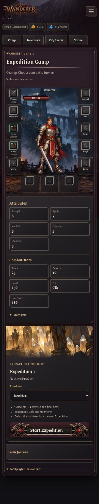
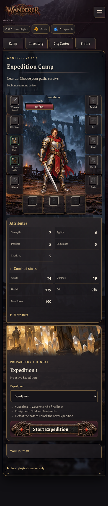
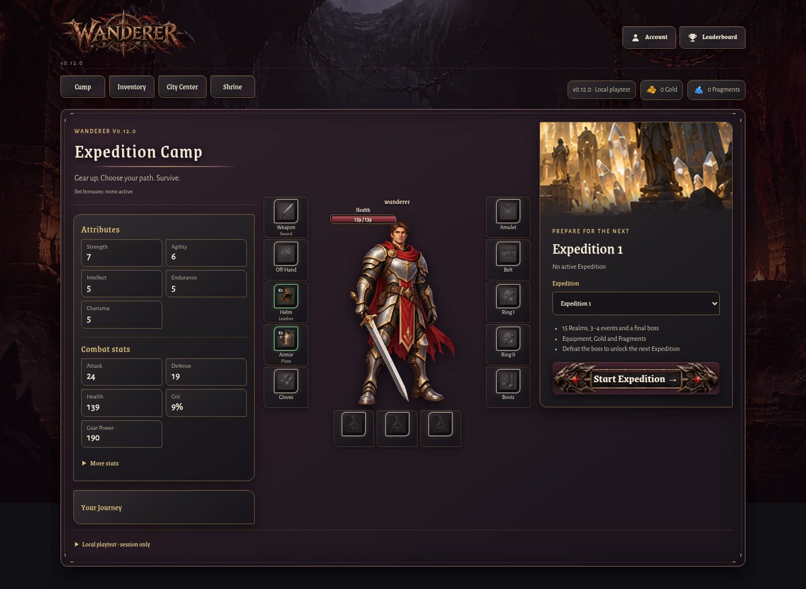
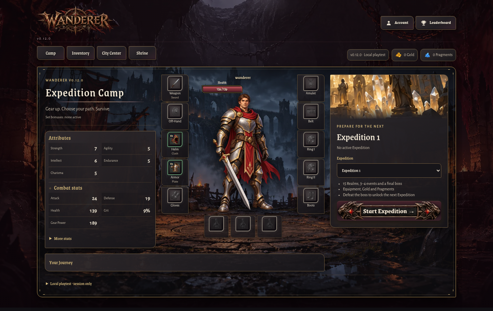
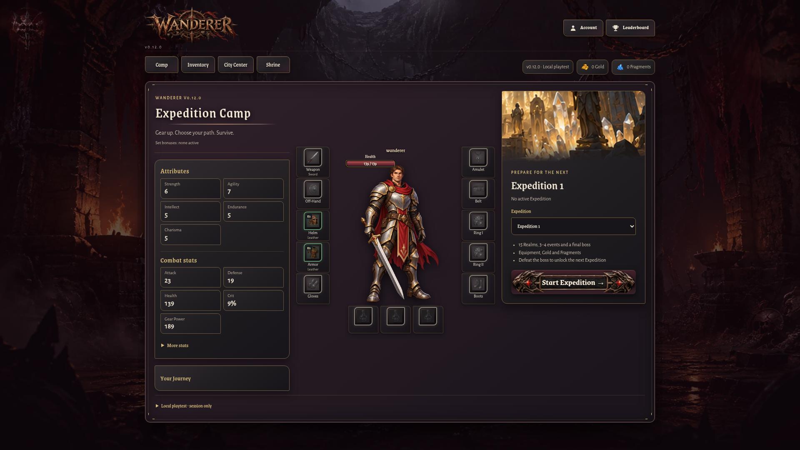
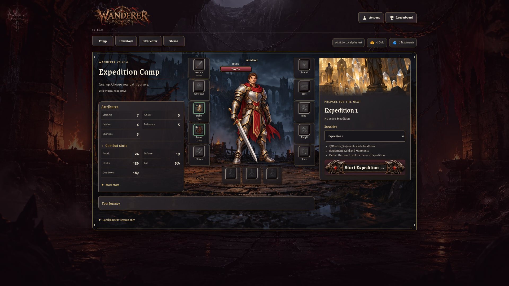

# Expedition Camp UI Refinement

Branch: `development`
Base: `e7ba6d4`
Scope: Camp presentation only; no game state, rules, economy, saves, or Firebase changes.

## Root cause and changes

The original Camp background remains in `assets/backgrounds/camp.webp` (the matching source image also remains under `assets/source/ux39/`). A broad screen-level surface rule in `v012-ui4f.css` had greater specificity than the Camp background and replaced it with an opaque wine gradient. The screen-surface selector now excludes `.phase3Camp`; its existing Camp-only CSS again supplies the original scene with `background-size: cover` and soft horizontal/vertical scrims.

The Camp now uses three compact columns, with Your Journey as a short footer spanning the Stats and Character columns. Stats retain two columns but use compact, aligned label/value rows and a small Gothic divider. Expedition spacing and its existing image were reduced slightly. The ten existing gear slots and three potion slots remain in their existing positions and handlers. Health/Mana track geometry is taller; Mana remains governed by its existing 0/0 visibility rule. The original Start Expedition button markup and left/right/center artwork are unchanged; only a restrained shadow lifts it visually.

At desktop widths, the character image container grows from 342px to 386px high (about 13%) while preserving `object-fit: contain`; the mobile sizing also grows while keeping the original aspect ratio. No new artwork was added or substituted.

## Before / after captures

Captured with the isolated Chromium preview and synthetic in-memory state.

| Viewport | Before | After |
|---|---|---|
| 390 × 844 |  |  |
| 1440 × 900 |  |  |
| 1920 × 1080 |  |  |

## Validation

- `npm test`: **PASS**, 290/290.
- `tests/ui-camp-refinement-browser.cjs`: **PASS**, 390, 1440 and 1920px; background asset and cover rule, no horizontal overflow, 10 gear slots, 3 potion slots, touch dimensions, original button art, item-details dialog, and Camp/Inventory navigation.
- `tests/v012-ui1-browser.cjs`: **PASS**, six existing desktop/mobile viewports, including gear comparison and potion select/remove.
- `tests/ui-gothic-gold-camp-browser.cjs`: **PASS**, 375, 430, 768, 1440 and 1920px.
- JavaScript syntax checks and `git diff --check`: **PASS**.
- Visual inspection: desktop scene is visible between the dark side panels; character is larger and centered; Journey closes the lower layout. On mobile the Camp retains its scene under the portrait and panels without clipping.

Safari/WebKit was not available for this run and remains pending. No other screens were intentionally restyled.
