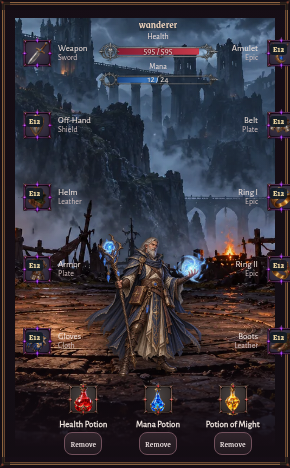
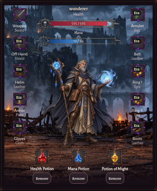
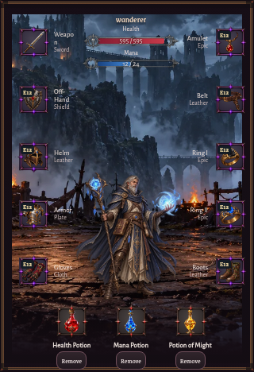
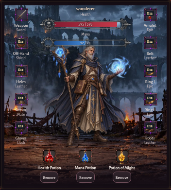
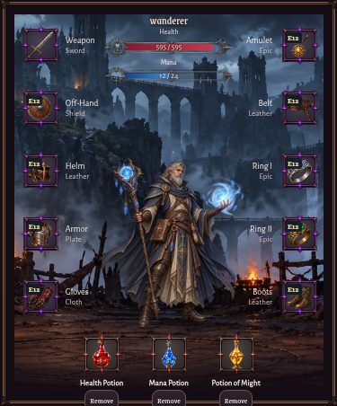
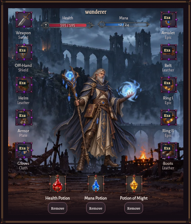
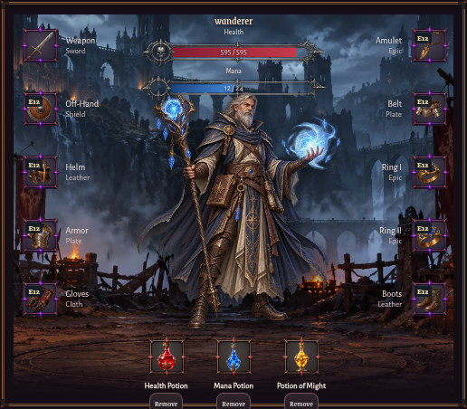
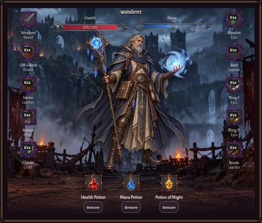
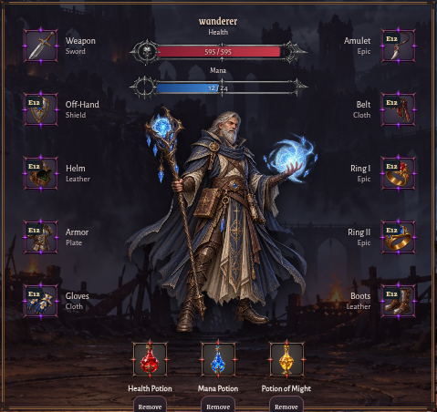
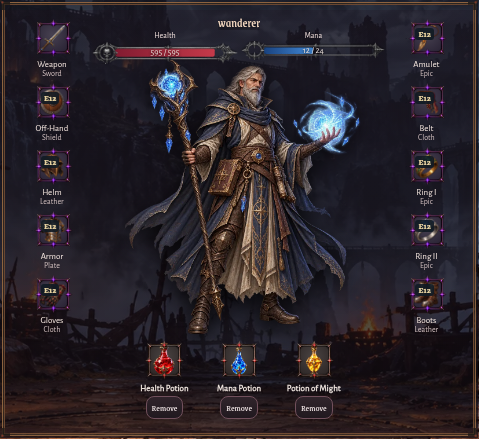

# UI.8b — Correção final do layout do Camp

Estado: **PASS em Chromium nos cinco viewports pedidos**. A validação Safari não foi executada.

## Diagnóstico e alterações

As colunas mínimas da grelha eram maiores do que o papel em 360–768 px, causando overflow interno e comprimindo o retrato. O `` quadrado ocupava apenas 56% da largura e era ajustado a uma caixa alta de cinco linhas; por isso, o personagem ficava pequeno e baixo. As labels aceitavam quebra dentro de palavras e disputavam espaço horizontal com as molduras.

Em `online/v012-ui5-camp.css`, consolidei a grelha em três colunas dimensionadas pelo painel, reduzi as cinco linhas e deixei a sexta linha das poções crescer apenas até ao conteúdo. O retrato passa a usar a coluna central, mantendo `object-fit: contain` e escala uniforme. No mobile, a janela ganha a largura necessária dentro dos limites do Camp; frames, nome e subtipo ficam empilhados, com labels sem quebra artificial. Health/Mana ficam compactos em duas colunas no desktop e em coluna no mobile. As poções continuam na mesma grelha, diretamente após o equipamento. Não alterei HTML de gameplay nem lógica de equipamento/poções.

## Medidas Chromium antes → depois

O “papel” é `.phase3CampCharacter .paper`; “retrato” é a caixa visível calculada pela área não transparente da imagem (`object-fit: contain`), não o tamanho do elemento ``. Poções mostra a coordenada vertical da grelha.

| Viewport | Janela da personagem | Papel | Área visível do retrato | Topo das poções |
|---|---:|---:|---:|---:|
| 360×780 | 290×467 → 322×392 | 260×428 → 304×369 | 135×142 → 170×180 | 742 → 665 px |
| 390×844 | 320×467 → 352×390 | 290×428 → 334×367 | 150×159 → 198×209 | 742 → 665 px |
| 768×1024 | 374×451 → 374×438 | 344×418 → 344×405 | 178×188 → 193×203 | 587 → 557 px |
| 1024×768 | 516×451 → 516×438 | 486×418 → 486×405 | 252×266 → 257×272 | 589 → 559 px |
| 1440×900 | 478×451 → 478×438 | 448×418 → 448×405 | 232×245 → 257×272 | 592 → 562 px |

As larguras mobile aumentam para acomodar os três trilhos sem scroll horizontal; permanecem dentro do viewport. As alturas reduzem entre 13 e 77 px. Weapon e Off-Hand aparecem inteiros em todas as larguras. Os cinco slots de cada lado, HUD, poções e molduras permanecem visíveis e clicáveis.

## Capturas antes/depois

Capturas reais de Chromium com personagem e inventário sintéticos, em cada viewport:

| Viewport | Antes | Depois |
|---|---|---|
| 360×780 |  |  |
| 390×844 |  |  |
| 768×1024 |  |  |
| 1024×768 |  |  |
| 1440×900 |  |  |

## Testes

- `node tests/v012-ui8b-camp-browser.cjs` — **PASS, 5/5 viewports**: overflow, 10 slots, 3 poções, labels, limites do HUD, proporção/descarga das imagens, não sobreposição do retrato opaco e centro dos botões clicável.
- `node tests/v012-ui8-camp-browser.cjs` — **PASS, 5/5 viewports** após atualizar a asserção de label para o layout vertical.
- `node tests/v012-ui1-browser.cjs` — **PASS, 6/6 viewports**, incluindo seleção/remoção de poção e Equipment/Inventory.
- `node tests/v012-ui4e-browser.cjs` — **PASS**, cinco viewports; compra Apothecary, uso de poção e save/reload sintético.
- `npm test` — **PASS, 287/287**. A primeira execução encontrou uma expectativa antiga para a altura fixa da linha das poções; atualizei-a para a linha auto dimensionada e a execução seguinte passou.
- `git diff --check` — **PASS**.

## Pendências

- Safari/WebKit não foi validado nesta tarefa.
- As capturas usam o retrato e estado de equipamento sintéticos do teste; nenhum save real foi lido ou modificado.
- Não alterei Camp fora do painel central, Inventory, City Center, Shrine, combate, economia, autenticação, saves ou deploys.
